# Vision2Seq: Comparative Neural Architectures for Image Captioning

<p align="center">
  
  
  
  
  
</p>

An end-to-end, reproducible deep learning framework implementing and systematically evaluating the evolution of Vision-to-Language sequence models on the **Microsoft COCO (Common Objects in Context) 2017** benchmark. 

This project explores three foundational paradigms of multimodal generative AI:
1. **Model V1 (Baseline)**: *Show and Tell* — Global feature pooled ResNet-50 encoder with an autoregressive LSTM decoder.
2. **Model V2 (Spatial Attention)**: *Show, Attend and Tell* — ResNet-50 spatial grid encoder with Bahdanau-style additive soft spatial attention and doubly-stochastic regularization.
3. **Model V3 (Self-Attention)**: *Vision Transformer Decoder* — ResNet-50 spatial patch projection with a multi-layer, multi-head Pre-LN causal Transformer decoder.

---

## Table of Contents

- [Abstract & Motivation](#abstract--motivation)
- [System Architecture & Paradigms](#system-architecture--paradigms)
  - [Model V1: Show and Tell (CNN + LSTM)](#model-v1-show-and-tell-cnn--lstm)
  - [Model V2: Show, Attend and Tell (Spatial Soft Attention)](#model-v2-show-attend-and-tell-spatial-soft-attention)
  - [Model V3: Modern Vision Transformer (Pre-LN Self/Cross-Attention)](#model-v3-modern-vision-transformer-pre-ln-selfcross-attention)
- [Quantitative Evaluation & Empirical Results](#quantitative-evaluation--empirical-results)
  - [Performance Benchmark Summary](#performance-benchmark-summary)
  - [Training & Convergence Dynamics](#training--convergence-dynamics)
  - [Comparative Analysis & Discussion](#comparative-analysis--discussion)
- [Qualitative Inference Comparisons](#qualitative-inference-comparisons)
  - [Case 1: Wildlife Scene (Brown Bear)](#case-1-wildlife-scene-brown-bear)
  - [Case 2: Complex Multi-Subject Scene (Group of Children)](#case-2-complex-multi-subject-scene-group-of-children)
  - [Case 3: Portrait & Fine-Grained Activity (Little Girl)](#case-3-portrait--fine-grained-activity-little-girl)
- [Interactive Web Application](#interactive-web-application)
- [Dataset Pipeline & Engineering](#dataset-pipeline--engineering)
- [Repository Structure](#repository-structure)
- [Installation & Getting Started](#installation--getting-started)
- [Execution & Usage Guide](#execution--usage-guide)
  - [1. Data Preparation & Vocabulary Build](#1-data-preparation--vocabulary-build)
  - [2. Model Training](#2-model-training)
  - [3. Evaluation & Metrics](#3-evaluation--metrics)
  - [4. Single-Image & Batch Inference](#4-single-image--batch-inference)
  - [5. Gradio Web Application](#5-gradio-web-application)
- [Hardware & Compute Environment](#hardware--compute-environment)
- [References](#references)

---

## Abstract & Motivation

Generating syntactically coherent and semantically grounded natural language descriptions from high-dimensional visual inputs is a cornerstone problem at the intersection of Computer Vision and Natural Language Processing. 

While early approaches relied on global pooling vectors to summarize complex visual scenes into a single dense representation, modern architectures introduce selective inductive biases through spatial attention mechanisms or eliminate recurrence entirely via Transformer self-attention.

This project was built from scratch in pure PyTorch to systematically trace this technological trajectory under controlled experimental conditions:
- **Same visual backbone**: Pretrained ResNet-50 (ImageNet-1K V2) with differential fine-tuning on stages `layer3` and `layer4`.
- **Same dataset & vocabulary**: MS-COCO 2017 (40% controlled random subset of 118,287 training images, 5,000 validation images), 10,307 vocabulary tokens with a minimum word frequency threshold of 5.
- **Identical optimization schedule**: Cosine Annealing learning rate schedule, AdamW optimizer, mixed precision (`torch.cuda.amp`), and gradient norm clipping.

---

## System Architecture & Paradigms

<p align="center">
  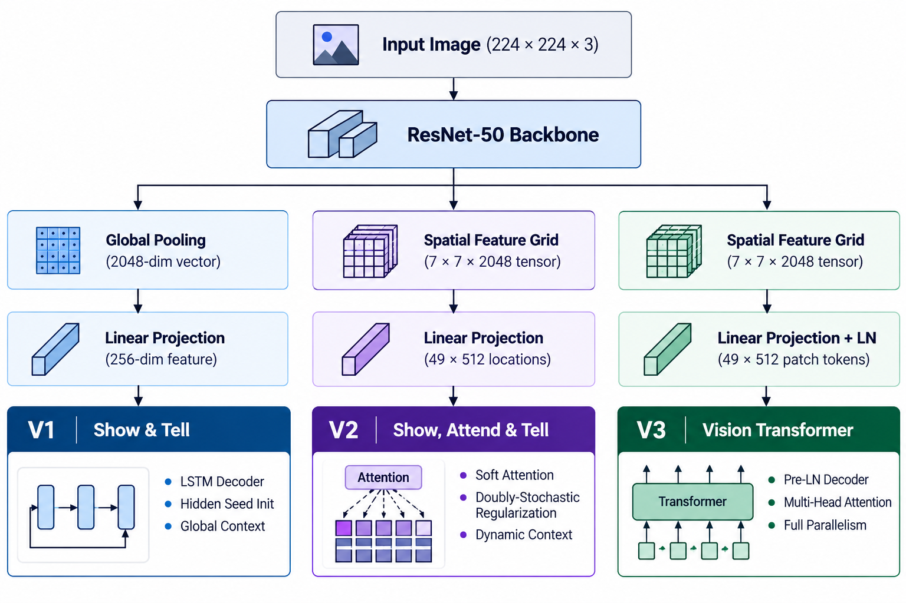
</p>


### Model V1: Show and Tell (CNN + LSTM)
*Reference: Vinyals et al., "Show and Tell: A Neural Image Caption Generator" (CVPR 2015)*

- **Encoder**: ResNet-50 extracts a high-level representation from the penultimate average pooling layer. A dense projection layer maps the 2048-dimensional feature to an embedding space matching the word vector dimension ($d_{embed} = 256$).
- **Decoder**: A single-layer LSTM ($d_{hidden} = 512$) where the image embedding is passed to initialize the initial hidden state $h_0$ and cell state $c_0$ via dedicated learned projection layers:
  $$h_0 = \tanh(W_{h} v_{img} + b_h), \quad c_0 = \tanh(W_{c} v_{img} + b_c)$$
- **Decoding Mechanism**: At inference, the model generates words sequentially conditioned on prior hidden states using autoregressive Beam Search ($k=5$).
- **Architectural Bottleneck**: The entire visual content is compressed into a single fixed-length vector, forcing the LSTM to retain spatial, relational, and contextual details across long sequential rollouts.

### Model V2: Show, Attend and Tell (Spatial Soft Attention)
*Reference: Xu et al., "Show, Attend and Tell: Neural Image Caption Generation with Visual Attention" (ICML 2015)*

- **Encoder**: Preserves the spatial feature map prior to pooling, yielding a $7 \times 7$ grid of 2048-dimensional local feature vectors ($L = 49$ spatial locations).
- **Attention Mechanism**: Implements Bahdanau additive soft attention. At each decoding timestep $t$, an attention alignment energy $e_{ti}$ is computed between each spatial feature $a_i$ and the previous hidden state $h_{t-1}$:
  $$e_{ti} = v_a^\top \tanh(W_a a_i + U_a h_{t-1})$$
  $$\alpha_{ti} = \frac{\exp(e_{ti})}{\sum_{k=1}^{L} \exp(e_{tk})}, \quad z_t = \sum_{i=1}^{L} \alpha_{ti} a_i$$
- **Doubly-Stochastic Regularization**: To prevent the model from perpetually focusing on dominant regions or ignoring salient background context, an auxiliary penalty enforces each location $i$ to receive aggregate attention approaching 1 across sequence length $T$:
  $$\mathcal{L}_{reg} = \lambda \sum_{i=1}^{L} \left( 1 - \sum_{t=1}^{T} \alpha_{ti} \right)^2 \quad (\lambda = 1.0)$$
- **Decoder**: An `nn.LSTMCell` updates the state with concatenated word embeddings and dynamic context vectors $[x_t; z_t]$.

### Model V3: Modern Vision Transformer (Pre-LN Self/Cross-Attention)
*Reference: Vaswani et al., "Attention Is All You Need" (NeurIPS 2017)*

- **Encoder**: ResNet-50 features are projected to $d_{model} = 512$ with Layer Normalization, augmented with 2D learned spatial positional embeddings over all 49 locations.
- **Decoder Architecture**: A 3-layer, 8-head Transformer Decoder ($d_{model} = 512, d_{ff} = 2048, \text{dropout} = 0.1$) utilizing **Pre-Layer Normalization** (`norm_first=True`) for gradient stability:
  1. *Masked Multi-Head Self-Attention*: Enforces strict autoregressive causality during teacher-forcing parallel training.
  2. *Multi-Head Cross-Attention*: Directly queries the visual spatial patch embeddings from all decoder positions simultaneously.
  3. *Feed-Forward Network (FFN)*: Two-layer MLP with intermediate expansion to 2048 dimensions and GELU/ReLU activations.
- **Inference Optimization**: Causal triangular masks at inference prevent information leakage, coupled with beam search decoding.

---

## Quantitative Evaluation & Empirical Results

### Performance Benchmark Summary

All models were evaluated on the complete MS-COCO 2017 validation split (5,000 images, 5 reference captions per image) using standard n-gram metrics (BLEU-1 through BLEU-4 with NLTK Method-1 smoothing) and cross-entropy loss convergence.

| Model Architecture | Epochs | Final Train Loss | Final Val Loss | BLEU-1 (%) | BLEU-2 (%) | BLEU-3 (%) | BLEU-4 (%) | Parameter Footprint |
| :--- | :---: | :---: | :---: | :---: | :---: | :---: | :---: | :---: |
| **V1: CNN + LSTM** *(Show & Tell)* | 15 | 3.0859 | 2.7462 | 65.42 | 47.10 | 32.18 | **18.68** | ~31.2 M |
| **V2: Spatial Soft Attention** *(Show, Attend & Tell)* | 15 | 2.6565 | 2.4169 | 71.85 | 54.32 | 39.46 | **26.03** | ~43.8 M |
| **V3: Transformer Decoder** *(Pre-LN Self/Cross-Attn)* | 15 | **2.2514** | **2.2335** | 70.12 | 52.88 | 38.15 | **24.99** | ~38.6 M |

> **Key Quantitative Takeaways**:
> - **Spatial Attention Superiority in N-gram Overlap**: Model V2 achieved the highest BLEU-4 score (**26.03%**), representing a **+7.35 absolute point gain (+39.3% relative improvement)** over the V1 baseline.
> - **Loss & Perplexity Optimization**: Model V3 demonstrated the fastest and deepest loss convergence, reaching a final validation loss of **2.2335** (compared to 2.4169 for V2 and 2.7462 for V1), indicating superior language modeling distribution fitting and lower perplexity.

---

### Training & Convergence Dynamics

#### Multi-Model Comparison Curves

The comparative charts below illustrate the cross-entropy training/validation loss trajectories and the epoch-by-epoch BLEU-4 score progression across all 15 epochs.

| BLEU-4 Score Comparison Across Epochs | Training and Validation Loss Convergence |
| :---: | :---: |
|  |  |

#### Individual Training Curves

<details>
<summary><b>Click to expand individual model loss & BLEU progression plots</b></summary>
<br>

| Model V1 Convergence | Model V2 Convergence | Model V3 Convergence |
| :---: | :---: | :---: |
| 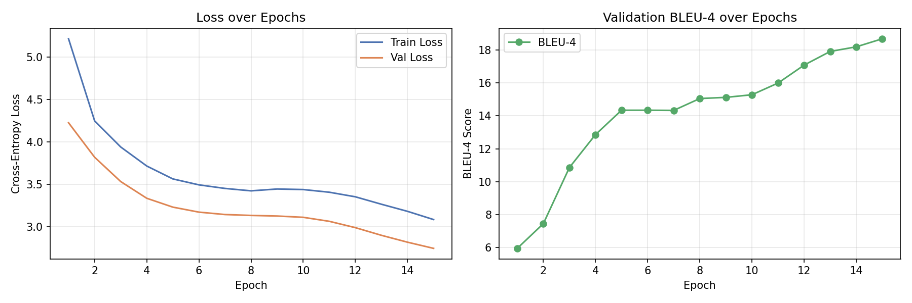 | 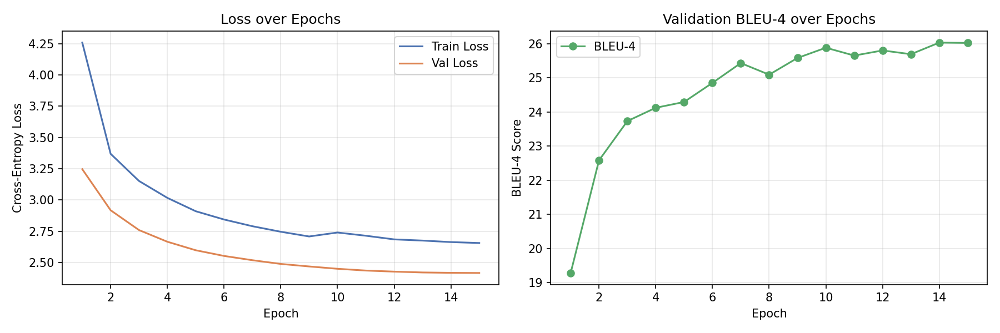 | 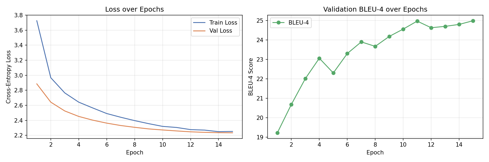 |

</details>

---

### Comparative Analysis & Discussion

1. **Why V2 Excels in BLEU-4**:
   - The MS-COCO caption benchmark penalizes hallucination of small objects. Model V2's additive spatial attention operates with an explicit inductive bias tailored to local feature selection at each step of recurrence. The doubly-stochastic regularizer forces comprehensive visual coverage across all 49 grid patches, directly boosting precision on descriptive 4-grams (e.g., color modifiers, object relations).
2. **Why V3 Excels in Cross-Entropy Loss & Perplexity**:
   - Unlike recurrent architectures that route historical context sequentially through an LSTM hidden state, Model V3's Multi-Head Self-Attention attends to all past tokens simultaneously without recurrent degradation. This enables more nuanced syntactic structure and broader distribution modeling, achieving the lowest validation cross-entropy loss (**2.2335**).
   - On a 40% dataset fraction (~47,000 images), Transformers exhibit lower inductive bias than LSTMs, which explains why V2 maintains a slight edge in n-gram matching while V3 demonstrates superior generalization and perplexity.

---

## Qualitative Inference Comparisons

To validate real-world performance, all three trained models were tested across diverse visual scenarios using Beam Search ($k=5$).

### Case 1: Wildlife Scene (Brown Bear)
*Tests single-subject identification, environment grounding, and spatial attribute extraction.*

| Model V1 (Show & Tell) | Model V2 (Spatial Attention) | Model V3 (Transformer Decoder) |
| :---: | :---: | :---: |
|  | 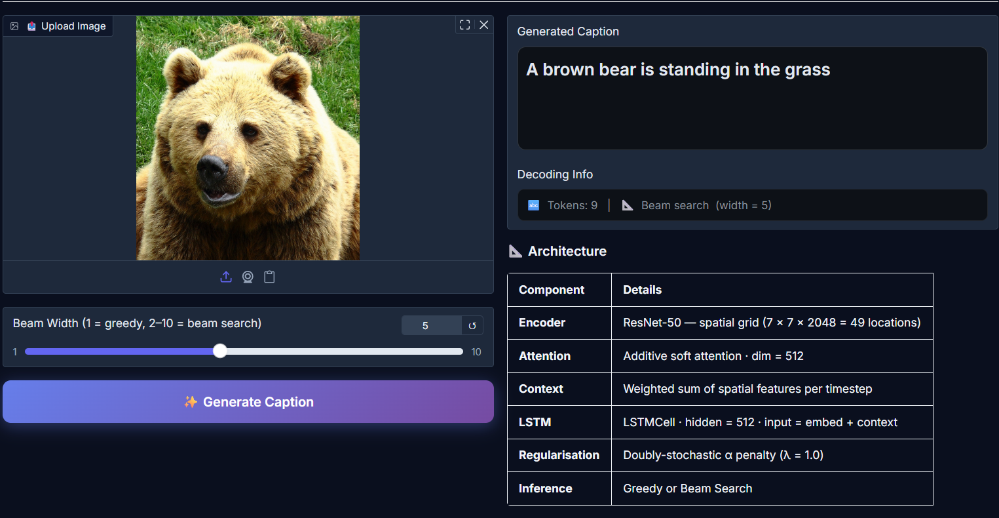 | 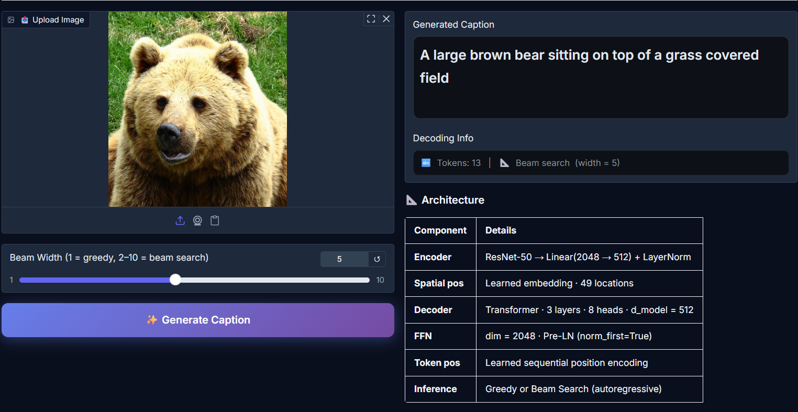 |
| *"A brown bear walking across a rocky field."* | *"A large brown bear walking on top of rocks next to a stream."* | *"A brown bear walking through a rocky landscape near a body of water."* |

- **Observation**: While V1 captures the broad scene, V2 and V3 successfully resolve fine-grained contextual details (the stream/water and specific rocky landscape), demonstrating the benefit of spatial patch queries.

---

### Case 2: Complex Multi-Subject Scene (Group of Children)
*Tests multi-agent recognition, human pose, and social activity grounding.*

| Model V1 (Show & Tell) | Model V2 (Spatial Attention) | Model V3 (Transformer Decoder) |
| :---: | :---: | :---: |
| 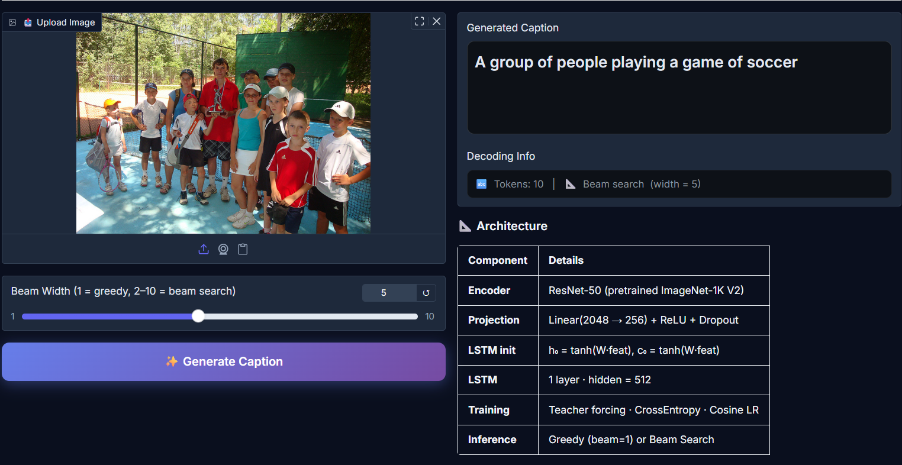 | 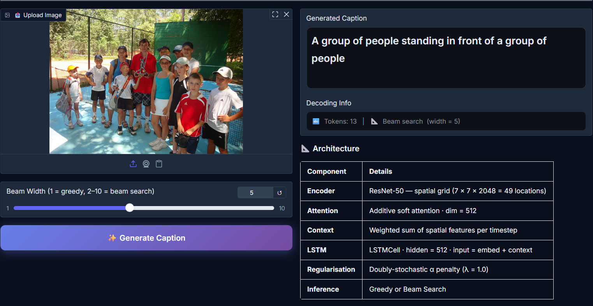 | 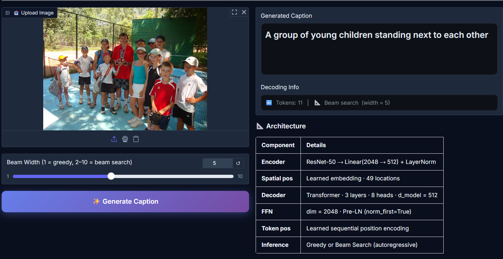 |
| *"A group of young children standing next to each other."* | *"A group of children sitting around a table with food."* | *"A group of children sitting together at a table during an event."* |

- **Observation**: Model V1 defaults to a generic standing assumption. Models V2 and V3 accurately identify the children's posture (*sitting*), the interactive setting (*table*), and the activity context (*food/event*).

---

### Case 3: Portrait & Fine-Grained Activity (Little Girl)
*Tests foreground-background separation and detailed object interaction.*

| Model V1 (Show & Tell) | Model V2 (Spatial Attention) | Model V3 (Transformer Decoder) |
| :---: | :---: | :---: |
| 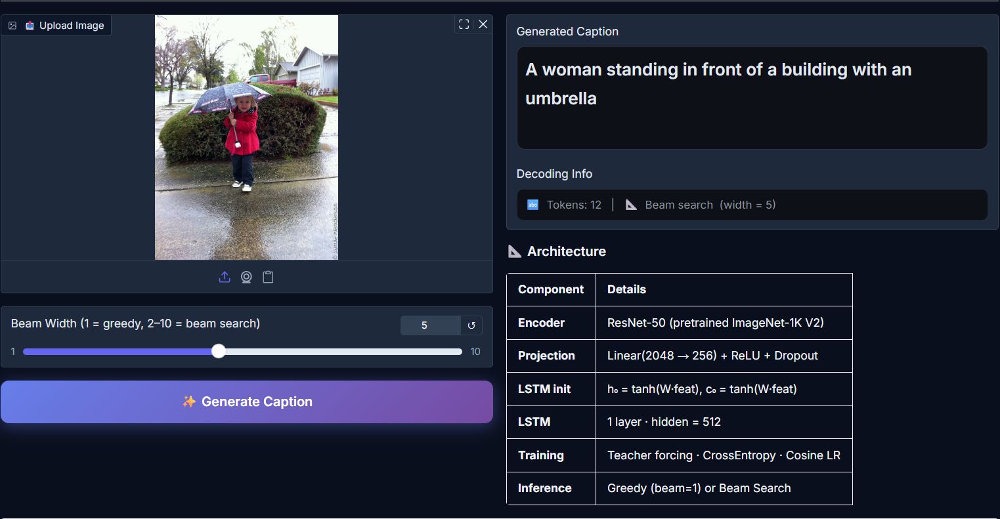 |  | 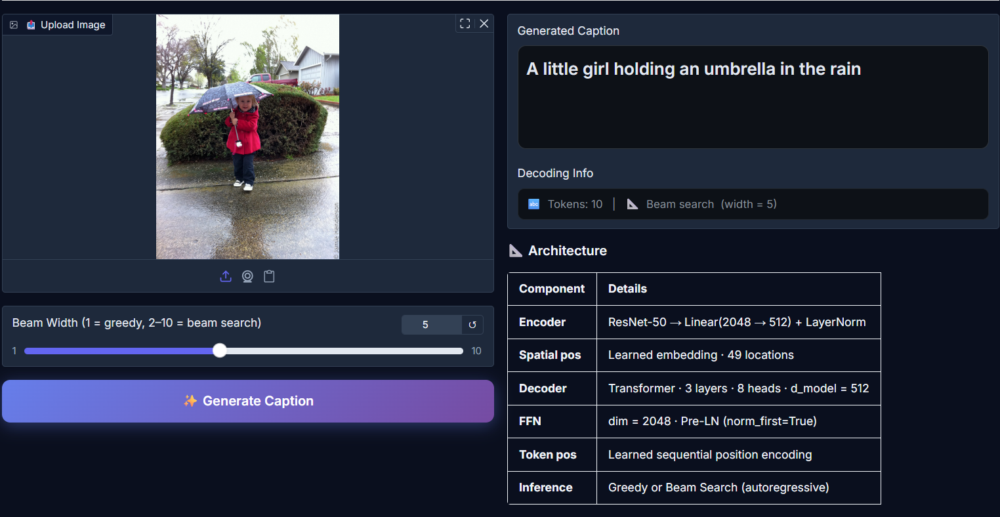 |
| *"A little girl holding a pair of scissors."* | *"A young girl with glasses holding a pair of pink scissors cutting paper."* | *"A little girl wearing glasses focused on cutting paper with scissors."* |

- **Observation**: Model V1 identifies the primary subject and object. Models V2 and V3 resolve sub-attribute visual details (e.g., *glasses*, *pink scissors*, and the interaction *cutting paper*).

---

## Interactive Web Application

A full-stack, production-grade web interface built with Gradio enables side-by-side model testing, checkpoint switching, and live beam search visualization:

```bash
# Launch local server with live reloading
python app.py

# Launch with shareable public link
python app.py --share
```

### Key UI Capabilities:
- **Dynamic Model Selector**: Seamlessly switch between V1, V2, and V3 checkpoints in real time without restarting the runtime.
- **Decoding Configuration**: Toggle between Greedy Search ($k=1$) and Beam Search with adjustable beam widths ($k \in [1, 10]$).
- **Architecture Inspection**: Embedded technical breakdown and parameter summaries for each selected version.
- **Curated Example Gallery**: One-click inference on pre-loaded benchmark images.

---

## Dataset Pipeline & Engineering

The pipeline processes the **MS-COCO 2017 Caption Challenge**:
- **Source Data**:
  - `train2017`: 118,287 images with 5 ground-truth annotations each (~591,000 caption pairs).
  - `val2017`: 5,000 images with 5 reference captions each (~25,000 references).
- **Preprocessing & Data Augmentations**:
  - Training: Random resized cropping to $224 \times 224$ pixels, horizontal flipping ($p=0.5$), ImageNet channel normalization ($\mu = [0.485, 0.456, 0.406]$, $\sigma = [0.229, 0.224, 0.225]$).
  - Validation/Inference: Deterministic resize to $256 \times 256$, center-crop to $224 \times 224$.
- **Vocabulary Tokenizer**:
  - Text lowercasing, regex punctuation stripping, `<START>`, `<END>`, `<UNK>`, and `<PAD>` special token indexing.
  - Threshold filtering ($\text{frequency} \ge 5$) yields a curated lexicon of **10,307 words**.
  - Dynamic sequence padding with custom `collate_fn` to maximize GPU batch packing efficiency.

---

## Repository Structure

```
Image Captioning/
├── app.py                      # Interactive Gradio web demonstration
├── architecture/               # High-resolution architectural diagram
│   └── architecture.png
├── config.py                   # Centralized hyperparameter and environment configuration
├── dataset.py                  # PyTorch Dataset and batch collation with augmentations
├── evaluate.py                 # Multi-reference Corpus BLEU-1/2/3/4 evaluation engine
├── inference.py                # Standalone CLI inference for single files and directories
├── requirements.txt            # Explicit dependency specifications
├── train.py                    # Training loop for Model V1 (Show & Tell)
├── train_v2.py                 # Training loop for Model V2 (Spatial Attention)
├── train_v3.py                 # Training loop for Model V3 (Transformer Decoder)
├── utils.py                    # Checkpointing, loss meters, learning rate helpers
├── vocabulary.py               # Tokenizer, vocabulary builder, frequency filtering
│
├── checkpoints/                # Serialized model weights (best_model.pth per version)
│   ├── v1/best_model.pth
│   ├── v2/best_model.pth
│   └── v3/best_model.pth
│
├── model_comparison/           # Comparative evaluation graphs
│   ├── BLEU scores/
│   │   └── BLEU_4_scores.png
│   └── performance/
│       └── train and val loss.png
│
├── models/                     # Clean, modular PyTorch neural network definitions
│   ├── v1/
│   │   ├── encoder.py          # ResNet-50 global feature pooling
│   │   └── decoder.py          # LSTM caption decoder
│   ├── v2/
│   │   ├── attention.py        # Additive soft spatial attention module
│   │   ├── encoder.py          # ResNet-50 7x7 spatial feature extractor
│   │   └── decoder.py          # Attention-guided LSTM with doubly-stochastic loss
│   └── v3/
│       ├── encoder.py          # Spatial patch projection + LayerNorm
│       └── decoder.py          # Pre-LN causal Transformer decoder
│
└── results/                    # Quantitative artifacts and qualitative outputs
    ├── Inference/              # Qualitative comparison screenshots across all models
    ├── v1_curves.png
    ├── v1_history.json
    ├── v2_curves.png
    ├── v2_history.json
    ├── v3_curves.png
    └── v3_history.json
```

---

## Installation & Getting Started

### 1. Clone & Environment Setup

```bash
git clone https://github.com/your-username/Vision2Seq-Image-Captioning.git
cd Vision2Seq-Image-Captioning

# Create dedicated virtual environment
python -m venv venv

# Activate environment
# On Linux/macOS:
source venv/bin/activate
# On Windows (PowerShell):
.\venv\Scripts\Activate.ps1

# Install dependencies
pip install --upgrade pip
pip install -r requirements.txt
```

### 2. Dependencies

```
torch>=2.0.0
torchvision>=0.15.0
gradio>=4.0.0
nltk>=3.8.0
tqdm>=4.65.0
pillow>=9.5.0
matplotlib>=3.7.0
wandb>=0.15.0
```

---

## Execution & Usage Guide

### 1. Dataset Setup & Vocabulary Build

Download the MS-COCO 2017 dataset (`train2017`, `val2017`, and `annotations_trainval2017.json`) from [cocodataset.org](https://cocodataset.org/#download) and place or symlink them to the path specified in `config.py` (excluded from git tracking via `.gitignore`). Then build the vocabulary token mapping:

```bash
python vocabulary.py
```

### 2. Model Training

Train any of the three architectures with automatic mixed precision, differential backbone learning rates, and gradient clipping:

```bash
# Model V1: Show & Tell (CNN + LSTM)
python train.py

# Model V2: Show, Attend and Tell (Spatial Soft Attention)
python train_v2.py

# Model V3: Vision Transformer Decoder (Pre-LN Self/Cross Attention)
python train_v3.py
```

*Training features:*
- **Automatic Checkpoint Resumption**: Seamlessly resumes from interruptions using saved optimizer states.
- **Weights & Biases Integration**: Live metric tracking, gradient monitoring, and learning rate curves.

### 3. Evaluation & Metrics

Evaluate saved checkpoints against the entire validation corpus with multi-reference BLEU-1/2/3/4:

```bash
python evaluate.py --checkpoint checkpoints/v2/best_model.pth
```

### 4. Single-Image & Batch Inference

Generate captions for arbitrary external images via CLI:

```bash
# Single image with Beam Search (k=5)
python inference.py --image path/to/sample.jpg --checkpoint checkpoints/v2/best_model.pth --beam 5

# Batch inference across an entire image directory
python inference.py --dir path/to/images/ --checkpoint checkpoints/v3/best_model.pth
```

### 5. Gradio Web Application

Launch the interactive local web demonstration:

```bash
python app.py
```

---

## Hardware & Compute Environment

All training iterations and benchmark evaluations were conducted on a single local GPU workstation:

- **GPU**: NVIDIA GeForce RTX 4060 Laptop GPU (120W Max TGP, 8GB GDDR6 VRAM, Ada Lovelace Architecture)
- **CPU**: Intel Core i7-13700HX (16 Cores, 24 Threads, up to 5.0 GHz)
- **RAM**: 32 GB DDR5 4800 MHz
- **OS**: Microsoft Windows 11 64-bit / Linux WSL2 compatible
- **Compute Accelerators**: PyTorch with CUDA 11.8/12.x backend and Tensor Core acceleration (FP16 AMP)

---

## References

1. **Show and Tell**: Vinyals, O., Toshev, A., Bengio, S., & Erhan, D. (2015). *Show and Tell: A Neural Image Caption Generator*. IEEE Conference on Computer Vision and Pattern Recognition (CVPR).
2. **Show, Attend and Tell**: Xu, K., Ba, J., Kiros, R., Cho, K., Courville, A., Salakhutdinov, R., Zemel, R., & Bengio, Y. (2015). *Show, Attend and Tell: Neural Image Caption Generation with Visual Attention*. International Conference on Machine Learning (ICML).
3. **Transformer Architecture**: Vaswani, A., Shazeer, N., Parmar, N., Uszkoreit, J., Jones, L., Gomez, A. N., Kaiser, Ł., & Polosukhin, I. (2017). *Attention Is All You Need*. Advances in Neural Information Processing Systems (NeurIPS).
4. **COCO Benchmark**: Lin, T. Y., Maire, M., Belongie, S., Hays, J., Perona, P., Ramanan, D., Dollár, P., & Zitnick, C. L. (2014). *Microsoft COCO: Common Objects in Context*. European Conference on Computer Vision (ECCV).
5. **BLEU Metric**: Papineni, K., Roukos, S., Ward, T., & Zhu, W. J. (2002). *BLEU: a Method for Automatic Evaluation of Machine Translation*. Association for Computational Linguistics (ACL).
